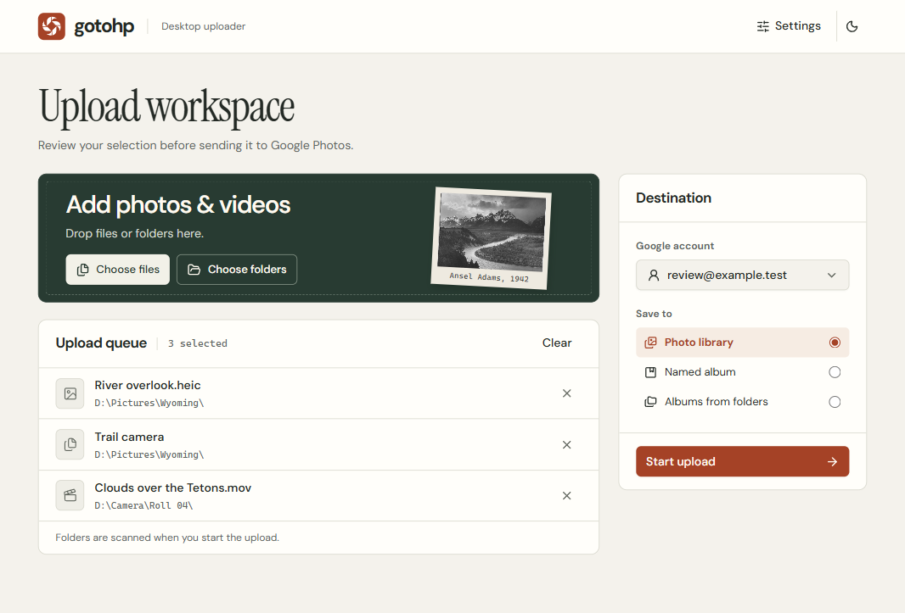

# gotohp

An unofficial Google Photos desktop and command-line client. Mxlted maintains this fork of [xob0t/gotohp](https://github.com/xob0t/gotohp).

## Review an upload

Drop files and folders onto the window, or use **Choose files** and **Choose folders**. Review the selected paths, remove any you want to leave out, and choose the photo library, a named album, or albums based on folder names. You can open **Settings** while reviewing. **Start upload** scans the selected folders using those settings.



## Features

- Unlimited uploads (can be disabled)
- Drag-and-drop file upload interface
- Credential management
- Real-time upload progress tracking
- Configurable upload threads
- Individual files or directories uploads, with optional recursive scanning
- Skips files already present in your account
- CLI mode
- Configurable, persistent upload settings (stored in "%system config path%/gotohp/gotohp.config")  
   You can force local config by creating empty gotohp.config next to executable.

## CLI usage

The standalone CLI runs without the GUI. To inspect a folder before signing in, run an offline preview.

```shell
gotohp-cli upload /path/to/photos --recursive --dry-run
```

The JSON output lists each planned item and its paths. It includes Live Photo pairs, skipped groups, and metadata warnings when pairing is enabled. A dry run reads local media only. Checks for items already in Google Photos take place during an actual upload.

```shell
gotohp-cli upload /path/to/photos --recursive --threads 5
gotohp-cli creds add "<oauth_token cookie value>"   # Embedded Setup sign-in, see below
gotohp-cli creds add "androidId=..."                 # or a raw credential string
gotohp-cli creds add - < token.txt                   # or read either from stdin
gotohp-cli creds set user@gmail.com
```

This fork uses the same `gotohp.config` location as upstream. For uploads the CLI reads the stored account and takes its upload settings from flags. Pass `--config <path>` to use a separate config file and `--account <email>` to select a stored account.

Run `gotohp-cli help` or `gotohp-cli upload --help` for all commands and options.

The GUI binary runs the same CLI when given a command, e.g. `gotohp upload ...`.

## Sign in

### Option 1 - Embedded setup

1. Open gotohp and click **Add Google account**.
2. Click **Open Google sign-in** and sign in with the account you want to add.
3. Sign in on the Google Embedded Setup page and click **I agree**. The page may keep loading forever; this is expected.
4. Open the browser developer tools. Under Application or Storage, open Cookies for `accounts.google.com`.
5. Copy only the value of the `oauth_token` cookie and paste it into gotohp.
6. Click **Connect account**.

From the CLI, open the same page yourself and run `gotohp-cli creds add "<oauth_token value>"`.

### Option 2 - ReVanced. No root required

<details>
  <summary><strong>Click to expand</strong></summary>

1. Install Google Photos ReVanced on your android device/emulator.
   - Install GmsCore [https://github.com/ReVanced/GmsCore/releases](https://github.com/ReVanced/GmsCore/releases)
   - Install patched apk [https://github.com/RookieEnough/Morphe-AutoBuilds/releases](https://github.com/RookieEnough/Morphe-AutoBuilds/releases) or patch it yourself
2. Connect the device to your PC via ADB.
3. Open the terminal on your PC and execute

   Windows

   ```cmd
   adb logcat | FINDSTR "auth%2Fphotos.native"
   ```

   Linux/Mac

   ```shell
   adb logcat | grep "auth%2Fphotos.native"
   ```

4. If you are already using ReVanced - remove Google Account from GmsCore.
5. Open Google Photos ReVanced on your device and log into your account.
6. One or more identical GmsCore logs should appear in the terminal.
7. Copy text from `androidId=` to the end of the line from any log.
8. That's it! 🎉

</details>

### Option 3 - Official apk. Root required

<details>
  <summary><strong>Click to expand</strong></summary>

1. Get a rooted android device or an emulator.
2. Connect the device to your PC via ADB.
3. Install [HTTP Toolkit](https://httptoolkit.com)
4. In HTTP Toolkit, select Intercept - `Android Device via ADB`. Filter traffic with

   ```text
   contains(https://www.googleapis.com/auth/photos.native)
   ```

   Or if you have an older version of Google Photos, try

   ```text
   contains(www.googleapis.com%2Fauth%2Fplus.photos.readwrite)
   ```

5. Open Google Photos app and login with your account.
6. A single request should appear.  
   Copy request body as text.
7. Add that credential string in gotohp.
8. If gotohp asks for a token binding key, keep the rooted device connected and click `Read from ADB`. gotohp will read the account's `lstBindingKeyAlias` from Android AccountManager and save it into the credential.

#### Troubleshooting

- **No Auth Request Intercepted**
  1. Log out of your Google account.
  2. Log in again.
  3. Try `Android App via Frida` interception method in HTTP Toolkit.
- **Token binding key not found**
  1. Make sure the same Google account is present on the connected device.
  2. Make sure root is available to ADB.

</details>

## Build

Build the CLI from the repository root with Go 1.27. On Windows, run `go build -tags cli -o gotohp-cli.exe .`. On macOS or Linux, run `go build -tags cli -o gotohp-cli .`.

For the desktop app, install Node.js 24 and the native prerequisites for your platform. Put Go's binary directory on your PATH, then run the following commands from the repository root. [Wails installation guide](https://v3.wails.io/getting-started/installation/)

```shell
go install github.com/wailsapp/wails/v3/cmd/wails3@v3.0.0-beta.21
wails3 build
```

The desktop executable is written to `bin/`. Linux users can also build or run the fork with Nix. [Nix instructions](nix/README.md)

Pushing a version tag such as `v1.2.3` runs the release builds. Fork maintainers can enable automatic release pull requests by configuring `RELEASE_PLEASE_TOKEN` with contents and pull request write access.
